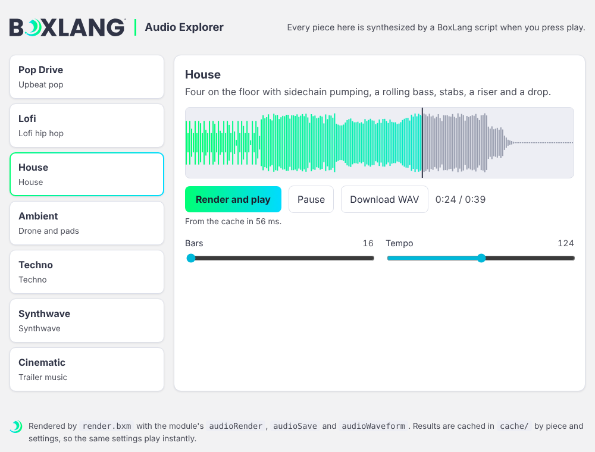

The explorer is a small BoxLang web app (`index.bxm` and `render.bxm`) that plays every piece of the examples catalog that does not need the speech engine (14 of 16) in the browser, with adjustable settings, a waveform and seeking. It runs on the BoxLang MiniServer.



```bash
bx-audio explorer                       # starts it at http://localhost:8080/index.bxm
bx-audio explorer --port=9090
```

It needs the [BoxLang MiniServer](https://boxlang.ortusbooks.com/boxlang-framework/miniserver) on your `PATH`. `bx-audio doctor` tells you if it is not.

## What it does

- A card for each piece: pick one, change its settings (bars, tempo, style, seed and the settings of that piece) and press Render.
- The piece is synthesized on the server by the same script as the command line, and cached by piece and settings, so the same settings play instantly the second time. Renders run one at a time, so a burst of requests queues instead of using up the memory. The cache is the `cache` folder next to `render.bxm` (the newest 40 renders are kept), and it is not covered by `bx-audio clean`, so delete that folder to free the space.
- A waveform of the render that you can click to seek.
- Light and dark themes in the BoxLang palette.

The speech and video examples are not in it: they download an engine or need FFmpeg, and a web page should not start a 150 MB download by itself. They run from the command line.

## Running it yourself

```bash
cd examples/explorer
boxlang-miniserver --webroot . --port 8080 --host 127.0.0.1
```

`bx-audio explorer` listens on this machine only (`127.0.0.1`). The MiniServer itself listens on every network interface unless you pass `--host`, so give it one when you start it yourself. To let others on your network use the explorer, run `bx-audio explorer --host=0.0.0.0`. The explorer renders audio on request, so do that only on a network you trust.

The explorer is also a worked example of a BoxLang web app that renders audio: read `render.bxm`.
