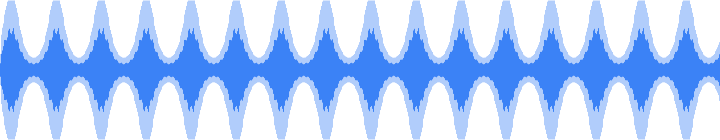
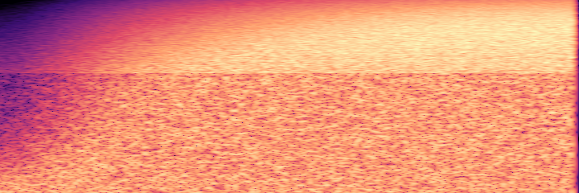
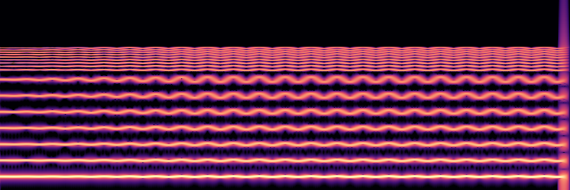
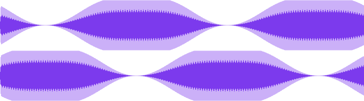

A curve is a value that changes with time. `audioLfo` makes one that swings up and down on its own, `audioCurve` makes one from points you choose. `audioModulate` points a curve at one parameter of a sound, and `audioAutomate` points one at a track of a timeline.

A curve is read at the time of the sound it drives: the value at 2 seconds is what the sound does 2 seconds in. `audioCurveAt( curve, seconds )` tells you what a curve says at a time, which is useful for checking a curve before you use it.

## Curves

An LFO has a `shape` (`sine`, `triangle`, `saw`, `square` or `random`), a `rate` in Hz, a `depth` and a `center`. It starts at the center and swings by the depth in each direction. `fadeIn` brings the swing in over some seconds, `phase` starts it elsewhere in its cycle, and `seed` makes `random` repeatable.

A curve from points holds the first value before the first point and the last value after the last, and joins the points with `linear`, `smooth` or `step`.

<!-- run -->
```js
wobble = audioLfo( shape="sine", rate=2, depth=3, center=10 );
println( audioCurveAt( curve=wobble, seconds=0 ) );
println( audioCurveAt( curve=wobble, seconds=0.125 ) );

rise = audioCurve( points=[ { at:0, value:200 }, { at:4, value:8000 } ], interpolation="smooth" );
println( audioCurveAt( curve=rise, seconds=2 ) );
```

## What a curve can drive

| `param` | The curve is | Typical use |
|---|---|---|
| `gainDb` | the gain in dB | Tremolo, fade, swell |
| `pan` | the position, -1 left to 1 right (a mono sound becomes stereo) | Auto pan |
| `cutoff` | the cutoff of a filter in Hz | Filter sweep, wah |
| `pitch` | the pitch in semitones, like a tape | Vibrato, a pitch drop, a tape stop |

`cutoff` takes a `filter` (`lowpass`, `highpass`, `bandpass` or `notch`) and a resonance `q`. A `pitch` curve that stays above 0 makes the sound shorter and below 0 longer, because it plays like a record. Around 0 (a vibrato) the length stays.

### Tremolo

<!-- run -->
```js
tone = audioOsc( "saw", 220, 4 );
tremolo = audioModulate( audio=tone, param="gainDb", curve=audioLfo( shape="sine", rate=4, depth=8, center=-8 ) );
audioSave( tremolo, "tremolo.wav" );
```

The volume swings 8 dB either side of -8 dB, four times a second:



<audio controls preload="none" src="../assets/audio/mod-tremolo.mp3"></audio>

### Filter sweep

<!-- run -->
```js
sweep = audioModulate( audio=audioNoise( seconds=4 ), param="cutoff",
    curve=audioCurve( points=[ { at:0, value:200 }, { at:4, value:8000 } ], interpolation="smooth" ) );
audioSave( sweep, "sweep.wav" );
```

White noise through a low pass that opens from 200 Hz to 8 kHz. The picture shows the bright part of the spectrum climbing:



<audio controls preload="none" src="../assets/audio/mod-sweep.mp3"></audio>

### Vibrato

<!-- run -->
```js
tone = audioOsc( "saw", 220, 4 );
vibrato = audioModulate( audio=tone, param="pitch", curve=audioLfo( shape="sine", rate=5.5, depth=0.4, fadeIn=1.5 ) );
audioSave( vibrato, "vibrato.wav" );
```

The pitch swings 0.4 of a semitone, 5.5 times a second, and the swing grows over 1.5 seconds. Every harmonic wobbles, the higher ones more:



<audio controls preload="none" src="../assets/audio/mod-vibrato.mp3"></audio>

### Auto pan

<!-- run -->
```js
tone = audioOsc( "saw", 220, 4 );
autoPan = audioModulate( audio=tone, param="pan", curve=audioLfo( shape="sine", rate=0.5, depth=1 ) );
audioSave( autoPan, "autopan.wav" );
```

A mono sound moves from the center to the right, across to the left and back, every two seconds. The two lanes are the two channels. Wear headphones for this clip:



<audio controls preload="none" src="../assets/audio/mod-autopan.mp3"></audio>

## Automating a track

`audioAutomate` does the same for a track of a timeline, while the timeline renders. It takes `gainDb` and `pan`. Calling it again for the same track and parameter replaces the curve. A `pan` curve needs a stereo timeline and balances the track (it is not a mono pan).

<!-- run -->
```js
t = audioTimeline( bpm=120, beatsPerBar=4, sampleRate=44100, channels=2 );
audioAdd( timeline=t, sound=audioOsc( "sine", 440, 4 ), at=0, track="lead" );
audioAutomate( timeline=t, track="lead", param="gainDb", curve=audioCurve( points=[ { at:0, value:-40 }, { at:2, value:0 }, { at:4, value:-40 } ] ) );
audioAutomate( timeline=t, track="lead", param="pan", curve=audioLfo( shape="triangle", rate=0.5, depth=0.8 ) );
audioSave( audioRender( timeline=t ), "swell.wav" );
```

## Errors

An unknown `param`, `shape` or `interpolation`, an empty or repeated-time `points` list, or a `curve` that is not from `audioLfo` or `audioCurve` is `bxaudio.invalidArgument`. A `pitch` curve that would make a sound longer than 10 minutes is `bxaudio.tooLarge`.
